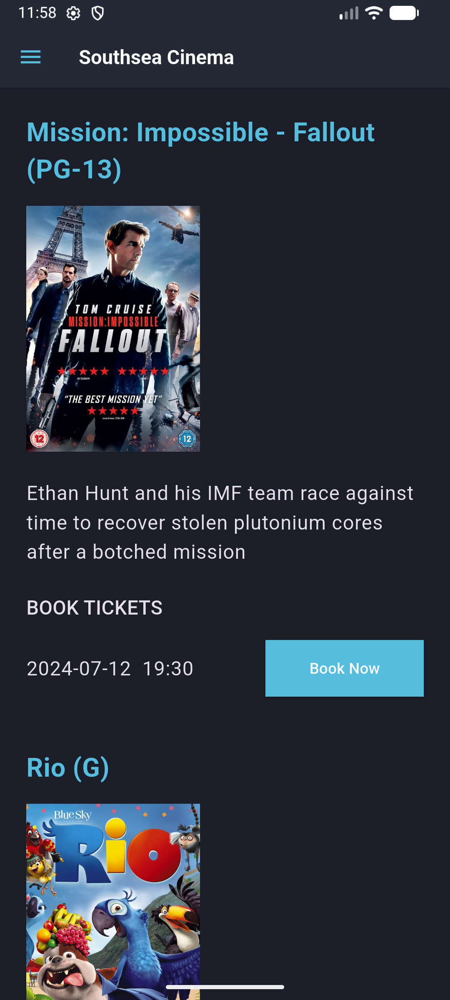
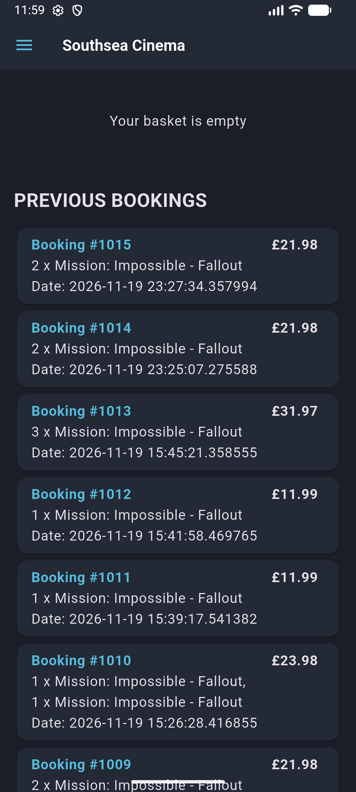
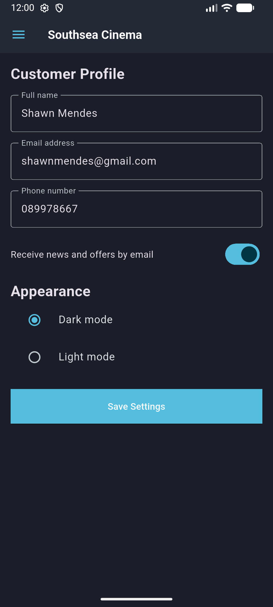

# Southsea Cinema

A Flutter app for browsing films, selecting tickets, reviewing a basket, and saving completed bookings in SQLite.

## Features

- Films are loaded from `assets/data/movies.json`.
- Film listings show a title, age rating, description, date, time, formatted price, and local poster image.
- Users can select from 0 to 5 tickets on a film listing.
- Selecting a quantity and choosing **ADD TO ORDER** appends a new basket line containing that film and quantity. Re-adding tickets creates another basket line rather than merging with the existing line.
- The basket displays ticket quantities, film details, line totals, a £2.00 service charge for each basket line, and the total due.
- Basket lines can be removed and the basket can be returned to for updating.
- Buying tickets saves the booking in SQLite and clears the basket.
- Saved bookings show their booking number, ticket summary, date, and total.
- The Settings screen saves a customer name, email address, phone number, and newsletter preference with `SharedPreferencesAsync`.
- The app supports a dark theme and a light theme.
- Dark mode is the default, and the selected theme is saved and restored.

## Platform

The app contains an unsupported-platform message for runs outside Android:

> This app saves bookings with SQLite and is set up to run on Android only.

Use an Android emulator or physical Android device for the full app.

## Screenshots

### Home



### Basket



### Settings



## Getting Started

### Prerequisites

- Flutter with the Android toolchain configured
- An Android emulator or Android device
- Git

### Clone

```bash
git clone <repository-url>
```

```bash
cd southsea_cinema
```

### Install Dependencies

```bash
flutter pub get
```

### Run

Start an Android emulator or connect a physical Android device, then run:

```bash
flutter run
```

## Tests

Run the automated unit and widget tests with:

```bash
flutter test
```

The existing tests cover:

- Home and film-listing widget behavior
- Basket totals, item removal, and clearing after checkout
- SQLite database setup and booking operations
- Booking and movie model behaviour
- Customer profile model behaviour
- Movie and basket repositories
- Settings fields and SharedPreferences-backed preferences
- The reusable cinema button

These tests use Flutter widget testing, in-memory `SharedPreferencesAsync`, and in-memory or FFI SQLite databases, so they do not require an emulator.

## Project Structure

```text
southsea_cinema/
├── assets/
│   ├── data/
│   │   └── movies.json
│   └── images/
├── lib/
│   ├── constants.dart
│   ├── main.dart
│   ├── database/
│   │   └── cinema_db.dart
│   ├── models/
│   │   ├── basket_item.dart
│   │   ├── booking.dart
│   │   ├── movie.dart
│   │   └── user_settings.dart
│   ├── repositories/
│   │   ├── basket_repository.dart
│   │   └── movie_repository.dart
│   ├── views/
│   │   ├── basket_view.dart
│   │   ├── bookings_view.dart
│   │   ├── home_view.dart
│   │   ├── movie_listing.dart
│   │   └── settings_view.dart
│   └── widgets/
│       ├── cinema_button.dart
│       ├── movie_card.dart
│       └── nav_drawer.dart
├── test/
│   ├── widget_test.dart
│   ├── database/
│   │   └── cinema_db_test.dart
│   ├── models/
│   │   ├── booking_test.dart
│   │   ├── movie_model_test.dart
│   │   └── user_settings_test.dart
│   ├── repositories/
│   │   ├── basket_repository_test.dart
│   │   └── movie_repository_test.dart
│   ├── views/
│   │   ├── basket_view_test.dart
│   │   └── settings_view_test.dart
│   └── widgets/
│       └── cinema_button_test.dart
├── pubspec.yaml
└── README.md
```

## Storage

- SQLite stores completed bookings in `cinema_data.db`.
- `SharedPreferencesAsync` stores profile details and the light/dark theme preference.
- Ticket selections and basket items remain in memory until checkout or app state reset.
